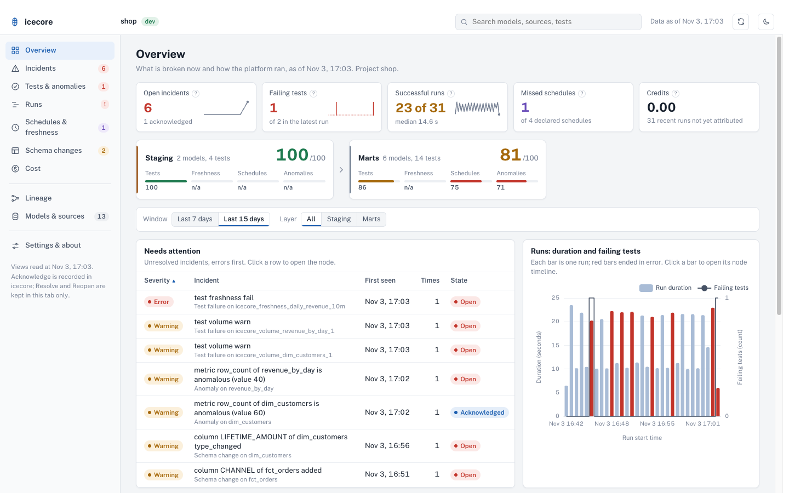
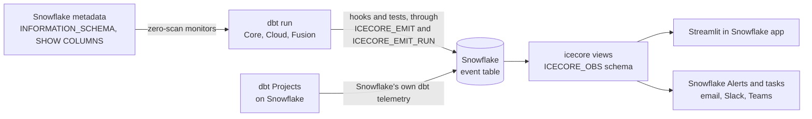

<p align="center">
  
</p>

<h1 align="center">icecore</h1>

<p align="center"><strong>dbt observability that lives inside Snowflake</strong></p>

<p align="center">
  <a href="https://github.com/crithink-dev/icecore/actions/workflows/ci.yml"></a>
  <a href="LICENSE"></a>
  <a href="#compatibility">=1.8 <3.0"></a>
  
  <br>
  <a href="#how-it-works"></a>
  <a href="#how-it-works"></a>
  <a href="#features"></a>
</p>

<p align="center"><sub>The three zeros are design rules. The exception: on Iceberg tables the shipped volume reader returns none; the opt-in <code>CHANGES</code> reader returns a net delta (inserts minus deletes), needs change tracking and reads data (<a href="spikes/S5.md">spike S5</a>).</sub></p>

## What icecore is

icecore is a dbt package for teams that run dbt on Snowflake. Your dbt runs write their results (runs, tests, metrics, cost) into Snowflake's own event table, so icecore owns no tables and needs no server.
Freshness, row count and schema monitors read Snowflake metadata instead of scanning your data, and score each metric against its own history.
You read it all through views, a Streamlit app (the Console) and Snowflake alerts.

**Why "icecore"?** Scientists drill ice cores to read the past layer by layer. icecore reads your dbt history the same way: every run leaves a layer in the event table, and you read down the core to find when a table went stale, a schema changed or a model got expensive.



> [!NOTE]
> **This is the first public release (`vX.Y.Z`).** It is tested on dbt Core and a Snowflake sandbox. See [Known limits](#known-limits) before you point it at a production project, and [report what you find](#report-an-issue).

## Requirements

- **Snowflake.** Standard edition works, with the account's active event table. Enterprise edition or above can also give the database its own event table. icecore uses an event table, Snowflake Scripting and Python stored procedures, and Alerts and Tasks (only if you turn the alerts on). Cortex anomaly detection is optional: without it the native engine scores.
- **Anaconda terms.** `ICECORE_EMIT_RUN` is a Python procedure that uses Snowflake's third-party Python packages, so your organization must have accepted the Anaconda terms (an organization administrator does this once, in Snowsight).
- **An active event table.** `SHOW PARAMETERS LIKE 'EVENT_TABLE' IN ACCOUNT;` must not be empty. If it is, an admin sets it: see the [quickstart](docs/quickstart.md#1-prepare-snowflake). `icecore.setup` never creates an event table or changes this association.
- **dbt.** dbt Core `>=1.8.0,<3.0.0` with `dbt-snowflake`. The test suite runs on dbt-core 1.8 (the floor) and on the latest release; dbt Cloud, dbt Fusion and dbt Projects on Snowflake are not tested yet.
- **Privileges for `icecore.setup`.** The role that runs it needs USAGE on the target database, CREATE SCHEMA on it (or ownership of an existing schema), CREATE PROCEDURE and CREATE VIEW on the schema, and read access to the event table the views read (the `EVENTS_VIEWER` application role when it is the account table). It needs CREATE TASK too when a model declares `meta.sla`. To set the log and trace levels itself it needs `MODIFY LOG LEVEL` and `MODIFY TRACE LEVEL` on the account; if it lacks them, `setup` prints the statement for an admin and carries on.
- **Privileges for the role that runs dbt.** USAGE on the database, the icecore schema and the procedures, and SELECT on the views. Details: [Configuration](docs/configuration.md#what-setup-creates).

## Install

Add icecore to `packages.yml`, pinned to the release tag, then install:

```yaml
# packages.yml
packages:
  - git: "https://github.com/crithink-dev/icecore.git"
    revision: vX.Y.Z
```

```bash
dbt deps
```

## Set up

**1. Add the two hooks** to `dbt_project.yml`. They are all run telemetry needs: `start_run` writes one `icecore.run_start` record when the run starts, and `end_run` sends the run's records at the end (the invocation, each node, test results, query events, the DAG's edges and one record with the run's status and node counts), all tagged with `dbt.invocation_id`.

```yaml
# dbt_project.yml
on-run-start: "{{ icecore.start_run() }}"
on-run-end: "{{ icecore.end_run(results) }}"
```

Both hooks write nothing until `setup` has created the procedures, and nothing when telemetry is off:

```yaml
# dbt_project.yml
vars:
  icecore:
    telemetry: false
```

A telemetry failure never fails your run: if the procedures or a grant are missing, icecore logs a warning and dbt carries on. On dbt 1.8, `dbt source freshness` runs no project hooks unless `flags: {source_freshness_run_project_hooks: true}` is set in `dbt_project.yml`; dbt 1.12 runs them by default ([spike S3](spikes/S3.md)).

**2. Run setup** once, as the role described above:

```bash
dbt run-operation icecore.setup --args '{runs_per_day: 24}'
```

It creates the schema `ICECORE_OBS` in your target database with the procedures and the views, and no tables. It prints an estimate of the rows and ingestion credits icecore will write per month (`runs_per_day` is how often dbt runs). Running it again changes nothing.

**3. Run dbt, then check the install.**

```bash
dbt build
dbt run-operation icecore.doctor
```

`doctor` never fails the run. It ends with `OK: <n> icecore records in the last 24 h`, or with `no records in 24 h` and the likely cause. Records reach the event table with a delay (about 8 seconds at p95, 20 at worst in our measurements, and about a minute before the first rows were readable in the quickstart check). The [quickstart](docs/quickstart.md) walks through each step with the expected output.

Setup details:

- `setup` detects the account's capabilities, creates the procedures `ICECORE_EMIT`, `ICECORE_EMIT_RUN` and `ICECORE_ACK` and the views, and checks the `LOG_LEVEL` and `TRACE_LEVEL` that apply to that schema (it needs `LOG_LEVEL` at least `INFO` and `TRACE_LEVEL` `ALWAYS`). It never proposes a database-wide `TRACE_LEVEL`. `schema` defaults to the `obs_schema` var (`ICECORE_OBS`); if you pass another schema, set the var to it too.
- The alerts and the silence task (missed-run detection) are created only when the var `alerts` is `true`, and then they are resumed: a resumed alert or task runs on a warehouse every period. See [Alerts and tasks](docs/configuration.md#alerts-and-tasks).
- Estimate alone: `dbt run-operation icecore.estimate_telemetry_cost --args '{runs_per_day: 24}'`.

## First monitors

Add monitor tests to the models and sources you care about. They read Snowflake metadata and scan no data, and write to the `METRICS` view:

```yaml
# models/schema.yml
models:
  - name: fct_orders
    data_tests:
      - icecore.volume
      - icecore.freshness:
          max_lag: 2h
```

The other monitors are `icecore.schema_changes`, `icecore.column_anomaly`, `icecore.all_columns_anomaly` and `icecore.dimension_anomaly`. Each metric is scored against the test's own history (30 days, at least 7 points; until then it only records metrics). An anomaly warns by default; set `vars: icecore: anomaly_severity: error` to make it fail the test. A threshold you wrote (`max_lag`, `min_rows`, `bounds`) fails the test. Arguments: [Configuration](docs/configuration.md#generic-tests). To declare a schedule and let icecore detect a missed run, add `meta.sla` to a model.

Then read the views, not the event table:

```sql
select test_name, "COLUMN", status, failures from ICECORE_OBS.TEST_RESULTS order by test_name;
```

All views, with their columns: [views reference](docs/reference/views.md).

## The app

The Console is one full-page Streamlit app: Overview, Incidents, Tests and anomalies, Runs, Schedules and freshness, Schema changes, Cost, Lineage, Models and sources, and Settings. It reads only the icecore views, and its one write is acknowledging an incident through `ICECORE_ACK`. Full guide: [docs/app.md](docs/app.md).

**Run it locally first (recommended).** No warehouse is kept running for the app: it holds a Snowflake session only while you use it. You need Python 3.10 to 3.13 and a clone of this repository (the app is not part of the dbt package install).

```bash
git clone https://github.com/crithink-dev/icecore.git && cd icecore
python3 -m venv .venv-app
.venv-app/bin/pip install -r streamlit/requirements-local.txt

export SNOWFLAKE_CONNECTION_NAME=<your connections.toml entry>   # or SNOWFLAKE_ACCOUNT + SNOWFLAKE_USER (browser login or key pair)
export ICECORE_VIEWS_SCHEMA=<DB>.ICECORE_OBS                      # default: <your database>.ICECORE_OBS
make app                                                          # then open http://localhost:8501
```

The role needs USAGE on the database and the views schema and SELECT on the views (and USAGE on `ICECORE_ACK` to acknowledge).

**Then deploy it to Streamlit in Snowflake** if your team wants one shared URL. Upload the files of the `streamlit/` folder, including `components/console/build/`, to a stage and create the app from it:

```sql
CREATE STREAMLIT <db>.<schema>.ICECORE_APP
  FROM @<db>.<schema>.<stage>/icecore_app
  MAIN_FILE = 'streamlit_app.py'
  QUERY_WAREHOUSE = <warehouse>;
GRANT USAGE ON STREAMLIT <db>.<schema>.ICECORE_APP TO ROLE <viewer_role>;
```

The exact steps (the PUT commands, the layout and the `snow streamlit deploy` option) are in [docs/app.md](docs/app.md#deploy-it-to-streamlit-in-snowflake). A deployed app needs a warehouse while someone has it open.

## Known limits

- **First release, tested on a sandbox.** The offline suite runs in CI on dbt-core 1.8 and on the latest release; the Snowflake suite runs on dbt 1.8 on manual dispatch. dbt Cloud, dbt Fusion and dbt Projects on Snowflake are not tested yet.
- **Standard edition.** icecore uses the account's active event table. Whether procedure records land in it from a database with no event table of its own is not measured yet ([Gate 1 open items](spikes/GATE1.md#open-items)).
- **Event-table delay.** Records appear in the views after a delay of seconds to about a minute.
- **Iceberg tables.** The shipped row-count reader returns nothing for them; an opt-in `CHANGES` reader exists, needs change tracking and does read data ([spike S5](spikes/S5.md)).
- **Views and external tables** have no row-count metadata, so `icecore.volume` cannot measure them.
- **Elementary-compatible views** are not created yet: `setup` with `compat` set prints `planned, not available yet`.
- **`setup` with `app: true`** does nothing yet: deploy the app as described above.
- **Alerts and tasks use a warehouse** once resumed (`alerts: true`).
- **Cost** appears hours after a run: Snowflake publishes query attribution with a lag, and a later dbt run writes the credits.
- **Resolve and Reopen** in the app are kept in the browser tab only. Acknowledge is the only recorded action.
- **Snowflake only**, for good.

## Report an issue

Open an issue on [GitHub](https://github.com/crithink-dev/icecore/issues/new/choose) with the bug template. Give your dbt version, Snowflake edition, icecore version, the command you ran, and the output of `dbt run-operation icecore.doctor` with account names and secrets removed. Never paste a password, a private key, an account identifier or a webhook URL. See also [Troubleshooting](docs/troubleshooting.md) and [SUPPORT](SUPPORT.md).

## Configuration

Run telemetry reads these keys of the `icecore` var in your `dbt_project.yml`. The values shown are the defaults:

```yaml
vars:
  icecore:
    telemetry: true          # false: start_run and end_run write nothing
    node_results: true       # end_run: one record per node result (status, rows, time, message, test failures)
    query_events: true       # end_run: the node's Snowflake query id, as an event on the node's span
    lineage: true            # end_run: the DAG's edges (parent, child unique ids) as LOG records
    samples: false           # true: end_run writes up to sample_rows failed rows of each failed test that stores its failures
    sample_rows: 10          # rows per sample
    sample_exclude_columns: [] # column names whose sampled values become '?', for example [email, phone]
    samples_on_warn: false   # true: also sample tests that only warned
    result_message: redacted # redacted, full or none
```

`result_message` controls how much of dbt's result message reaches the event table. dbt's message can quote data values from a Snowflake error, for example `Numeric value 'jane@x.com' is not recognized`, and people who can read the event table may not be allowed to read your data. `redacted`, the default, replaces every single-quoted literal with `'?'` and every double-quoted one with `"?"`, then cuts the message at 1,000 characters. `full` keeps dbt's text as it is. `none` leaves the message out.

Samples are off by default because they copy real row values from your tables into the event table, and anyone who can read the event table can read them, which may be more people than can read the data. To turn them on, set `samples: true`: each failed test that stores its failures (`store_failures`) then writes up to `sample_rows` rows. To keep sensitive values out, list the columns in `sample_exclude_columns` (any case): their names stay in each row and their values become `?`.


## How it works

icecore has one store, the Snowflake event table, and three paths around it: dbt writes to it, people read views over it, and Snowflake Alerts and tasks watch it.



- **Write path.** Gate 1 (31 Oct) chose two procedures, created by `icecore.setup` in the target database. `ICECORE_EMIT` (SQL) takes the frequent small writes, such as metric records from the generic tests, as span events with scope `global`. `ICECORE_EMIT_RUN` (Python) is called at `on-run-end`, in as many `CALL`s as its 512 KB chunks need, and writes the invocation and node spans with the real dbt timings, plus LOG records with attributes, under scope `icecore`. Each `CALL` is its own trace, and every record carries `dbt.invocation_id`, which groups a run. Spike S1 measured why: anonymous Snowflake Scripting blocks land nothing in the database's event table (for LOG records, the only ones checked, the record goes to the account table and only when the session sets `LOG_LEVEL`; SPAN and SPAN_EVENT routing there is unmeasured), while a procedure in the target database writes to that database's event table; and only the Python path gives real spans with explicit timings.
- **Read path.** `icecore.setup` creates views over the event table (and the two emitter procedures; no tables). Views are the only public interface: the app and your BI tools read views, never the raw table.
- **Control path.** Snowflake Alerts run against the views and notify through a notification integration. A Snowflake task detects runs that never happened.

<!-- SNOWSIGHT TRACE: add docs/assets/icecore-snowsight-trace.png (one dbt invocation's spans, one per node, grouped by dbt.invocation_id) once spans are emitted. -->

## Features

`shipped` means it is in this release. `planned` means on the [roadmap](docs/superpowers/plans/2026-10-30-icecore-roadmap.md), not started.

| Feature | What it does | Status |
| --- | --- | --- |
| **Zero-scan freshness reader** | `get_last_change_time` reads `SYSTEM$LAST_CHANGE_COMMIT_TIME`, with no warehouse scan. For a dynamic table it reports the last refresh. | `shipped` (macro) |
| **Zero-scan row count reader** | `get_row_count_metadata` reads `INFORMATION_SCHEMA.TABLES.ROW_COUNT` for standard, transient and dynamic tables. Views and external tables are not supported. | `shipped` (macro) |
| **Row count fallback over `CHANGES`** | `get_row_count_changes` returns a delta, not a total: the net rows since the last run (inserts minus deletes). Opt-in for Iceberg tables, where the metadata reader returns none; needs change tracking on the table. Cheap only for insert-only windows on large tables: after a DELETE or MERGE it read 1.8–1.9x the bytes of a full scan ([spike S5](spikes/S5.md)), and on a narrow table a small insert that rewrote a partly filled micro-partition read 2.7 MB against 3.6 MB for a full scan (PR #13). | `shipped` (macro, opt-in) |
| **Schema signature and diff** | `get_columns_signature` reads `SHOW COLUMNS`; `diff_schema` lists added, removed and retyped columns. | `shipped` (macro) |
| **Native anomaly engine** | `score` and `native__score`: pure SQL, seasonal median and MAD bands, the same output fields whatever engine scores. | `shipped` (macro) |
| **Root-cause walk** | `walk_upstream` and `classify_cause` find the nearest upstream failure, schema change or stale source in the dbt graph. Not yet wired to `on-run-end`. | `shipped` (macro) |
| **The Console (Streamlit app)** | One full-page app: Overview, Incidents, Tests and anomalies, Runs, Schedules and freshness, Schema changes, Cost, Lineage, Models and sources, Settings. Runs locally or in Streamlit in Snowflake ([docs/app.md](docs/app.md)). | `shipped` |
| **Telemetry write path** | Two procedures created by `icecore.setup` in the target database, chosen at Gate 1 (31 Oct) from spike S1: `ICECORE_EMIT` (SQL, frequent small writes such as test metrics) and `ICECORE_EMIT_RUN` (Python, at `on-run-end` in as many `CALL`s as needed: spans and LOG records, grouped by `dbt.invocation_id`). | `shipped` |
| **Traces in Snowsight** | Invocation and node spans with the real dbt timings, one trace per `CALL`, a run grouped by `dbt.invocation_id`, via the Python run emitter `ICECORE_EMIT_RUN` (S1: only the Python path gives real spans). | `shipped` |
| **SLA and alert settings in YAML** | `collect_sla_config` reads `meta.sla` and `meta.alerts` from your models. | `shipped` |
| **Column monitors over `CHANGES`** | Column metrics read over `CHANGES` since the last run. Cheap for insert-only windows on large tables; after a DELETE or MERGE, `CHANGES` reads every rewritten micro-partition (1.8–1.9x a full scan, S5). | `shipped` |
| **Run telemetry hooks** | `icecore.start_run()` and `icecore.end_run(results)`: invocation, node and test results, sent at `on-run-end` through `ICECORE_EMIT_RUN`, in as many `CALL`s as needed and grouped by `dbt.invocation_id`. | `shipped` |
| **Monitor tests** | `icecore.freshness`, `icecore.volume`, `icecore.schema_changes`, `icecore.column_anomaly`, `icecore.dimension_anomaly`. | `shipped` |
| **Setup and doctor** | `icecore.setup` creates the schema, the two emitter procedures and the views, and checks the levels; `icecore.doctor` checks the install and counts the last 24 hours of records. | `shipped` |
| **Views** | Views such as `invocations`, `node_executions`, `test_results`, `metrics`, `schema_changes`, `lineage`, `alerts_feed`, created by `icecore.setup`; all exist. | `shipped` |
| **Cost per model** | Credits per node from `QUERY_ATTRIBUTION_HISTORY`; cost regressions scored like any metric. | `shipped` |
| **Missed-run detection** | A Snowflake task compares `meta.sla` schedules with the last successful run. | `shipped` |
| **Alerts** | Snowflake Alerts to email, Slack and Teams, with deduplication and acknowledgement from the app. | `shipped` |
| **Cortex engine and shadow scoring** | `SNOWFLAKE.ML.ANOMALY_DETECTION` when the account allows it, compared side by side with the native engine. | `shipped` |
| **Failed-row samples** | A capped sample of failing rows on test failure (payload limits from spike S2). | `shipped` |
| **Elementary-compatible views** | Elementary's table names and columns, so existing dashboards keep working. | `planned` |

## How icecore compares

Facts about each tool's design, not a benchmark. The icecore column describes the [design](docs/design/scope-and-architecture.md); the last column says how much of it exists today.

| | Elementary OSS | dbt_artifacts | icecore | icecore status |
| --- | --- | --- | --- | --- |
| **Owns tables** | Yes, inserted from hooks | Yes, uploaded from hooks | No: the event table, read through views | `shipped` |
| **Needs a CLI** | Yes, `edr` for the report and alerts | No | No: Streamlit in Snowflake and Snowflake Alerts | `shipped` |
| **Scans data for monitors** | Yes, monitors query the tables | No monitors | Not for freshness, row count and schema; column monitors read `CHANGES`, cheap only for insert-only windows on large tables | `shipped` |
| **Cost per model** | No | No | Yes, from `QUERY_ATTRIBUTION_HISTORY` | `shipped` |
| **Detects missed runs** | No | No | Yes, with a Snowflake task | `shipped` |
| **Traces in Snowsight** | No | No | Yes, via the Python run emitter | `shipped` |

Why each row holds:

- **Owns tables.** Elementary's package inserts into its own tables from hooks ([spec section 1](docs/design/scope-and-architecture.md#1-vision-and-positioning)); dbt_artifacts uploads dbt's artifacts into its own tables from an `on-run-end` hook. icecore's design writes nothing itself and owns no tables or stages ([section 3](docs/design/scope-and-architecture.md#3-architecture-overview)). Gate 1 kept that design: `icecore.setup` creates views and the two emitter procedures (plus the alerts and tasks), no tables, and records reach the event table through those procedures.
- **Needs a CLI.** Elementary needs its Python CLI to render the report and send alerts (section 1). dbt_artifacts produces tables only. icecore's UI is a Streamlit in Snowflake app and its alerts are Snowflake Alerts.
- **Scans data for monitors.** Elementary rescans data to compute metrics (section 1). icecore's freshness, row count and schema readers use metadata only ([spike S5](spikes/S5.md): correct within 2 s for standard, transient and dynamic tables). The opt-in `CHANGES` reader does read data: it returns a net delta (inserts minus deletes), needs change tracking, and is cheap only for insert-only windows on large tables. After a DELETE or MERGE it read 1.8–1.9x the bytes of a full scan (S5), and on a narrow table a small insert that rewrote a partly filled micro-partition read 2.7 MB against 3.6 MB for a full scan (PR #13, in review).
- **Cost per model.** Elementary OSS has no cost data (section 1); dbt_artifacts records execution times, not credits. icecore joins each node's query id to `QUERY_ATTRIBUTION_HISTORY`.
- **Detects missed runs.** A hook only fires when a run happens, so hook-based tools cannot see a run that did not (section 1). icecore's silence task compares declared schedules to the event table.
- **Traces in Snowsight.** Snowsight's trace viewer reads spans from an event table. Neither Elementary nor dbt_artifacts writes to one. icecore is designed to write invocation and node spans with the real dbt timings through its Python run emitter, `ICECORE_EMIT_RUN`. Gate 1 chose Python for that path because S1 measured that only Python gives real spans with explicit timings; the SQL emitter, `ICECORE_EMIT`, gives one trace per `CALL`, scope `global` and no custom spans.

## Coming from Elementary?

> [!TIP]
> icecore is designed to keep what Elementary got right: run and test results per invocation, failed-row samples, volume, freshness, schema and column monitors, lineage and Slack alerts. **Planned:** opt-in views with Elementary's table names and columns (`dbt_invocations`, `dbt_run_results`, `elementary_test_results` and others), so your dashboards keep working, plus a step-by-step migration guide. [Spike S4](spikes/S4.md) found that `edr report` also needs a node-metadata view and a samples view, planned for Phase 6.

## Compatibility

Targets from the design (`require-dbt-version: [">=1.8.0", "<3.0.0"]`). Only dbt Core is tested today.

| Runtime or edition | Target | Tested today |
| --- | --- | --- |
| dbt Core 1.8 to latest | Supported | Yes: CI runs the offline suite on dbt-core 1.8 and on the latest release; the sandbox suite runs on 1.8, on manual dispatch only |
| dbt Fusion 2.x | Supported | Not yet |
| dbt Cloud | Supported | Not yet |
| dbt Projects on Snowflake (`EXECUTE DBT PROJECT`) | Supported, through Snowflake's own dbt telemetry (how the views select those records is still to be defined) | Not yet |
| Snowflake Standard edition | Supported, with the account's active event table (that procedure records land there is not measured yet, [Gate 1](spikes/GATE1.md)) | Not yet |
| Snowflake Enterprise edition | Supported, optionally with a dedicated database-level event table | Not yet |

Changing the account-level event table needs `ACCOUNTADMIN`. `icecore.setup` is designed to print that statement for an admin, never to run it.

## Learn more

- [Scope and architecture](docs/design/scope-and-architecture.md): the full design, event-table conventions and spikes.
- [Roadmap](docs/superpowers/plans/2026-10-30-icecore-roadmap.md): six phases, three gates.
- [Example project](examples/shop/README.md): a small shop with the hooks and the freshness and volume tests, and a test you can break on purpose.
- [Quickstart](docs/quickstart.md): from an empty dbt project to the first icecore records.
- [The app](docs/app.md): run it on your laptop against your own account (recommended for developers) or deploy it to Snowflake.
- [Configuration](docs/configuration.md): every var, the setup, doctor and estimate operations, the hooks and the views.
- [Public roadmap](docs/roadmap.md): what is built, what comes next and what is only considered.
- [Contributing](CONTRIBUTING.md): how to run the tests and what a pull request must meet.
- [Event-table conventions](docs/conventions.md): what icecore writes to the event table, the attributes, and how to read it.
- [Views reference](docs/reference/views.md): every view `setup` creates, with columns, types and source keys.
- [Troubleshooting](docs/troubleshooting.md): by symptom, with how to confirm and the fix.
- [Spike S5](spikes/S5.md): how reliable zero-scan metadata is, per table kind.

## Develop icecore

```bash
cd integration_tests
python3 -m venv .venv && .venv/bin/pip install -r requirements-floor.txt
.venv/bin/pytest -m "not sandbox"      # offline checks
.venv/bin/pytest -m sandbox            # needs SNOWFLAKE_* variables and a bootstrapped sandbox
```

The full guide is [docs/development.md](docs/development.md): the two dbt environments (1.8 floor and latest), clean offline runs, sandbox setup and the `run_id` rule, the Elementary environment, CI, and pull-request rules (a person merges every pull request).

## Contributing

Issues and pull requests are welcome. Read [CONTRIBUTING](CONTRIBUTING.md) first. Start with [Develop icecore](#develop-icecore) to run the test suites, and read the [design](docs/design/scope-and-architecture.md) before proposing a new module.

<!-- enable at public release (Gate 3) -->
<!--
<a href="https://star-history.com/#crithink-dev/icecore&Date">
  <picture>
    <source media="(prefers-color-scheme: dark)" srcset="https://api.star-history.com/svg?repos=crithink-dev/icecore&type=Date&theme=dark">
    
  </picture>
</a>

**Contributors**

<a href="https://github.com/crithink-dev/icecore/graphs/contributors">
  
</a>
-->

## Licence

Apache-2.0, see [LICENSE](LICENSE). Published by Crithink.
