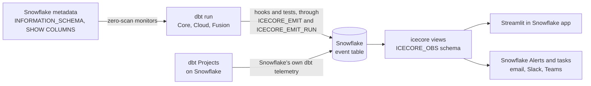

<p align="center">
  
</p>

<h1 align="center">icecore</h1>

<p align="center"><strong>dbt observability that lives inside Snowflake</strong></p>

<p align="center">
  <a href="https://github.com/crithink-dev/icecore/actions/workflows/ci.yml"></a>
  <a href="LICENSE"></a>
  <a href="#compatibility">=1.8 <3.0"></a>
  
  <br>
  <a href="#how-it-works"></a>
  <a href="#how-it-works"></a>
  <a href="#features"></a>
</p>

<p align="center"><sub>The three zeros are design rules. The exception: on Iceberg tables the shipped volume reader returns none; the opt-in <code>CHANGES</code> reader returns a net delta (inserts minus deletes), needs change tracking and reads data (<a href="spikes/S5.md">spike S5</a>).</sub></p>

icecore is a dbt package, in development, for teams that run dbt on Snowflake. It is designed to record runs, tests, metrics and cost in Snowflake's own event table, to watch freshness, volume and schema from metadata instead of scanning your data, and to show it all in a Streamlit in Snowflake app: no table to own, no CLI to install, no server to run.

**Why "icecore"?** Scientists drill ice cores to read the past layer by layer. icecore reads your dbt history the same way: every run leaves a layer in the event table, and you read down the core to find when a table went stale, a schema changed or a model got expensive.

> [!IMPORTANT]
> **icecore is pre-release.** It is in Phase 1 (foundations and spikes) and is not on dbt Hub yet. The [Features](#features) table says what is merged today (`shipped`), what is in progress (`building`) and what is still `planned`. Gate 1 (31 Oct) chose how telemetry is written: through two procedures that `icecore.setup` creates in the target database. That write path is being built.

<!-- APP GIF: add docs/assets/icecore-app.gif (Runs, Tests and anomalies, Lineage pages) once the pages read real views. -->

## Try it in 60 seconds

> [!NOTE]
> **Nothing is released yet.** The hooks (run telemetry) are planned from **0.1.0-alpha**, the `icecore.volume` and `icecore.freshness` tests from **0.2.0-beta**. The snippets show the planned interface from the [design](docs/design/scope-and-architecture.md); they will not work before those releases.

```yaml
# packages.yml
packages:
  - package: crithink-dev/icecore
    version: [">=0.1.0-alpha", "<1.0.0"]

# dbt_project.yml (hooks: from 0.1.0-alpha)
on-run-start: "{{ icecore.start_run() }}"
on-run-end: "{{ icecore.end_run(results) }}"

# models/schema.yml (tests: from 0.2.0-beta)
models:
  - name: fct_orders
    data_tests:
      - icecore.volume
      - icecore.freshness:
          max_lag: 2h
```

Then `dbt deps`, `dbt run-operation icecore.setup` (creates the views in `<target_db>.ICECORE_OBS` and the two emitter procedures, no tables) and `dbt build`.

The two hook lines are all run telemetry needs. `start_run` writes one `icecore.run_start` record when the run starts. `end_run` sends the run's records at the end, ending with one record that holds the run's status and node counts, all tagged with `dbt.invocation_id`. Both hooks write nothing when telemetry is off:

```yaml
# dbt_project.yml
vars:
  icecore:
    telemetry: false
```

A telemetry failure never fails your run: if the procedures or a grant are missing, icecore logs a warning and dbt carries on. On dbt 1.8, `dbt source freshness` runs no project hooks unless `flags: {source_freshness_run_project_hooks: true}` is set in `dbt_project.yml`; dbt 1.12 runs them by default ([spike S3](spikes/S3.md)).

### Set up and check the install

`setup` and `doctor` run today; the views, alerts, tasks and app that `setup` will also create are not built yet, and `setup` lists them as planned.

```bash
dbt run-operation icecore.setup --args '{schema: ICECORE_OBS, compat: none, app: false, runs_per_day: 24}'
dbt run-operation icecore.doctor
```

- `setup` detects the account's capabilities, creates the schema if it is missing, creates the procedures `ICECORE_EMIT` and `ICECORE_EMIT_RUN` in it, and checks the database's `LOG_LEVEL` and `TRACE_LEVEL`. When its role cannot set the levels, it prints the `ALTER DATABASE` statement for an admin. Running it again changes nothing, and grants on the procedures are kept. All arguments are optional; `schema` defaults to the `obs_schema` var (`ICECORE_OBS`). If you pass another schema, set the var to it too, because dbt runs write through the procedures of the var's schema.
- `setup` ends with an estimate of the rows icecore will write per month and the ingestion credits, from your node count and `runs_per_day`. Run it alone with `dbt run-operation icecore.estimate_telemetry_cost --args '{runs_per_day: 24}'`. For 100 nodes and 24 runs a day it estimates 149,760 rows and 0.0048 to 0.21 credits a month at Snowflake's published Telemetry Data Ingest rate (0.0212 credits per GB). It prints its assumptions and sources.
- `doctor` never fails. It checks the event table, the database's levels, makes one test `CALL` of each procedure, and counts icecore records of the last 24 hours. It ends with `OK: <n> icecore records in the last 24 h`, or with `no records in 24 h` and the likely cause, most often the hooks above.
- The role that runs `setup` needs USAGE on the database, CREATE SCHEMA on it (or an existing schema) and CREATE PROCEDURE on the schema ([Gate 1](spikes/GATE1.md#what-setup-creates-and-the-grants-it-needs)).

### Configuration

Run telemetry reads these keys of the `icecore` var in your `dbt_project.yml`. The values shown are the defaults:

```yaml
vars:
  icecore:
    telemetry: true          # false: start_run and end_run write nothing
    node_results: true       # end_run: one record per node result (status, rows, time, message, test failures)
    query_events: true       # end_run: the node's Snowflake query id, as an event on the node's span
    result_message: redacted # redacted, full or none
```

`result_message` controls how much of dbt's result message reaches the event table. dbt's message can quote data values from a Snowflake error, for example `Numeric value 'jane@x.com' is not recognized`, and people who can read the event table may not be allowed to read your data. `redacted`, the default, replaces every single-quoted literal with `'?'` and every double-quoted one with `"?"`, then cuts the message at 1,000 characters. `full` keeps dbt's text as it is. `none` leaves the message out.

The pre-releases are tagged 0.1.0-alpha, 0.2.0-beta and 0.3.0-beta, before 1.0.0. Naming a prerelease in the range lets `dbt deps` install them; with the range above it picks the newest one below 1.0.0 (checked against dbt-core 1.8.10's resolver).

## How it works

icecore has one store, the Snowflake event table, and three paths around it: dbt writes to it, people read views over it, and Snowflake Alerts and tasks watch it.



- **Write path** (`building`). Gate 1 (31 Oct) chose two procedures, created by `icecore.setup` in the target database. `ICECORE_EMIT` (SQL) takes the frequent small writes, such as metric records from the generic tests, as span events with scope `global`. `ICECORE_EMIT_RUN` (Python) is called at `on-run-end`, in as many `CALL`s as its 512 KB chunks need, and writes the invocation and node spans with the real dbt timings, plus LOG records with attributes, under scope `icecore`. Each `CALL` is its own trace, and every record carries `dbt.invocation_id`, which groups a run. Spike S1 measured why: anonymous Snowflake Scripting blocks write only to the account's event table, and only when the session sets `LOG_LEVEL` and `TRACE_LEVEL`, while a procedure in the target database writes to that database's event table; and only the Python path gives real spans with explicit timings.
- **Read path** (`planned`). `icecore.setup` creates views over the event table (and the two emitter procedures; no tables). Views are the only public interface: the app and your BI tools read views, never the raw table.
- **Control path** (`planned`). Snowflake Alerts run against the views and notify through a notification integration. A Snowflake task detects runs that never happened.

<!-- SNOWSIGHT TRACE: add docs/assets/icecore-snowsight-trace.png (one dbt invocation's spans, one per node, grouped by dbt.invocation_id) once spans are emitted. -->

## Features

`shipped` means merged on `develop` (not released). `building` means a story is in progress or in review. `planned` means on the [roadmap](docs/superpowers/plans/2026-10-30-icecore-roadmap.md), not started.

| Feature | What it does | Status |
| --- | --- | --- |
| **Zero-scan freshness reader** | `get_last_change_time` reads `SYSTEM$LAST_CHANGE_COMMIT_TIME`, with no warehouse scan. For a dynamic table it reports the last refresh. | `shipped` (macro) |
| **Zero-scan row count reader** | `get_row_count_metadata` reads `INFORMATION_SCHEMA.TABLES.ROW_COUNT` for standard, transient and dynamic tables. Views and external tables are not supported. | `shipped` (macro) |
| **Row count fallback over `CHANGES`** | `get_row_count_changes` returns a delta, not a total: the net rows since the last run (inserts minus deletes). Opt-in for Iceberg tables, where the metadata reader returns none; needs change tracking on the table. Cheap only for insert-only windows on large tables: after a DELETE or MERGE it read 1.8–1.9x the bytes of a full scan ([spike S5](spikes/S5.md)), and on a narrow table a small insert that rewrote a partly filled micro-partition read 2.7 MB against 3.6 MB for a full scan (PR #13). | `shipped` (macro, opt-in) |
| **Schema signature and diff** | `get_columns_signature` reads `SHOW COLUMNS`; `diff_schema` lists added, removed and retyped columns. | `shipped` (macro) |
| **Native anomaly engine** | `score` and `native__score`: pure SQL, seasonal median and MAD bands, the same output fields whatever engine scores. | `shipped` (macro) |
| **Root-cause walk** | `walk_upstream` and `classify_cause` find the nearest upstream failure, schema change or stale source in the dbt graph. Not yet wired to `on-run-end`. | `shipped` (macro) |
| **Streamlit app shell** | Navigation for six pages (Runs, Tests and anomalies, Lineage, Cost, SLAs, Settings) and the views schema setting. Pages show empty states until the views exist. | `shipped` (shell) |
| **Telemetry write path** | Two procedures created by `icecore.setup` in the target database, chosen at Gate 1 (31 Oct) from spike S1: `ICECORE_EMIT` (SQL, frequent small writes such as test metrics) and `ICECORE_EMIT_RUN` (Python, at `on-run-end` in as many `CALL`s as needed: spans and LOG records, grouped by `dbt.invocation_id`). | `building` |
| **Traces in Snowsight** | Invocation and node spans with the real dbt timings, one trace per `CALL`, a run grouped by `dbt.invocation_id`, via the Python run emitter `ICECORE_EMIT_RUN` (S1: only the Python path gives real spans). | `building` |
| **SLA and alert settings in YAML** | `collect_sla_config` reads `meta.sla` and `meta.alerts` from your models. | `building` |
| **Column monitors over `CHANGES`** | Column metrics read over `CHANGES` since the last run. Cheap for insert-only windows on large tables; after a DELETE or MERGE, `CHANGES` reads every rewritten micro-partition (1.8–1.9x a full scan, S5). | `building` |
| **Elementary compatibility target** | Pin the Elementary release the compatibility views follow; spike S4 on `edr report`. | `building` |
| **Run telemetry hooks** | `icecore.start_run()` and `icecore.end_run(results)`: invocation, node and test results, sent at `on-run-end` through `ICECORE_EMIT_RUN`, in as many `CALL`s as needed and grouped by `dbt.invocation_id`. | `building` |
| **Monitor tests** | `icecore.freshness`, `icecore.volume`, `icecore.schema_changes`, `icecore.column_anomaly`, `icecore.dimension_anomaly`. | `planned` |
| **Setup and doctor** | `icecore.setup` creates the schema and the two emitter procedures and checks the levels; `icecore.doctor` checks the install and counts the last 24 hours of records. | `building` |
| **Views** | Views such as `invocations`, `node_executions`, `test_results`, `metrics`, `schema_changes`, `lineage`, `alerts_feed`, created by `icecore.setup`. | `planned` |
| **Cost per model** | Credits per node from `QUERY_ATTRIBUTION_HISTORY`; cost regressions scored like any metric. | `planned` |
| **Missed-run detection** | A Snowflake task compares `meta.sla` schedules with the last successful run. | `planned` |
| **Alerts** | Snowflake Alerts to email, Slack and Teams, with deduplication and acknowledgement from the app. | `planned` |
| **Cortex engine and shadow scoring** | `SNOWFLAKE.ML.ANOMALY_DETECTION` when the account allows it, compared side by side with the native engine. | `planned` |
| **Failed-row samples** | A capped sample of failing rows on test failure (payload limits from spike S2). | `planned` |
| **Elementary-compatible views** | Elementary's table names and columns, so existing dashboards keep working. | `planned` |

## How icecore compares

Facts about each tool's design, not a benchmark. The icecore column describes the [design](docs/design/scope-and-architecture.md); the last column says how much of it exists today.

| | Elementary OSS | dbt_artifacts | icecore | icecore status |
| --- | --- | --- | --- | --- |
| **Owns tables** | Yes, inserted from hooks | Yes, uploaded from hooks | No: the event table, read through views | `building` (write path chosen at Gate 1) |
| **Needs a CLI** | Yes, `edr` for the report and alerts | No | No: Streamlit in Snowflake and Snowflake Alerts | `planned` (app shell `shipped`) |
| **Scans data for monitors** | Yes, monitors query the tables | No monitors | Not for freshness, row count and schema; column monitors read `CHANGES`, cheap only for insert-only windows on large tables | readers `shipped`, tests `planned` |
| **Cost per model** | No | No | Yes, from `QUERY_ATTRIBUTION_HISTORY` | `planned` |
| **Detects missed runs** | No | No | Yes, with a Snowflake task | `planned` |
| **Traces in Snowsight** | No | No | Yes, via the Python run emitter | `building` |

Why each row holds:

- **Owns tables.** Elementary's package inserts into its own tables from hooks ([spec section 1](docs/design/scope-and-architecture.md#1-vision-and-positioning)); dbt_artifacts uploads dbt's artifacts into its own tables from an `on-run-end` hook. icecore's design writes nothing itself and owns no tables or stages ([section 3](docs/design/scope-and-architecture.md#3-architecture-overview)). Gate 1 kept that design: `icecore.setup` creates views and the two emitter procedures (plus the alerts and tasks), no tables, and records reach the event table through those procedures.
- **Needs a CLI.** Elementary needs its Python CLI to render the report and send alerts (section 1). dbt_artifacts produces tables only. icecore's UI is a Streamlit in Snowflake app and its alerts are Snowflake Alerts.
- **Scans data for monitors.** Elementary rescans data to compute metrics (section 1). icecore's freshness, row count and schema readers use metadata only ([spike S5](spikes/S5.md): correct within 2 s for standard, transient and dynamic tables). The opt-in `CHANGES` reader does read data: it returns a net delta (inserts minus deletes), needs change tracking, and is cheap only for insert-only windows on large tables. After a DELETE or MERGE it read 1.8–1.9x the bytes of a full scan (S5), and on a narrow table a small insert that rewrote a partly filled micro-partition read 2.7 MB against 3.6 MB for a full scan (PR #13, in review).
- **Cost per model.** Elementary OSS has no cost data (section 1); dbt_artifacts records execution times, not credits. icecore joins each node's query id to `QUERY_ATTRIBUTION_HISTORY`.
- **Detects missed runs.** A hook only fires when a run happens, so hook-based tools cannot see a run that did not (section 1). icecore's silence task compares declared schedules to the event table.
- **Traces in Snowsight.** Snowsight's trace viewer reads spans from an event table. Neither Elementary nor dbt_artifacts writes to one. icecore is designed to write invocation and node spans with the real dbt timings through its Python run emitter, `ICECORE_EMIT_RUN`. Gate 1 chose Python for that path because S1 measured that only Python gives real spans with explicit timings; the SQL emitter, `ICECORE_EMIT`, gives one trace per `CALL`, scope `global` and no custom spans.

## Coming from Elementary?

> [!TIP]
> icecore is designed to keep what Elementary got right: run and test results per invocation, failed-row samples, volume, freshness, schema and column monitors, lineage and Slack alerts. **Planned:** opt-in views with Elementary's table names and columns (`dbt_invocations`, `dbt_run_results`, `elementary_test_results` and others), so your dashboards keep working, plus a step-by-step migration guide. [Spike S4](spikes/S4.md) found that `edr report` also needs a node-metadata view and a samples view, planned for Phase 6.

## Compatibility

Targets from the design (`require-dbt-version: [">=1.8.0", "<3.0.0"]`). Only dbt Core is tested today.

| Runtime or edition | Target | Tested today |
| --- | --- | --- |
| dbt Core 1.8 to latest | Supported | Yes: CI runs the offline suite on dbt-core 1.8 and on the latest release; the sandbox suite runs on 1.8, on manual dispatch only |
| dbt Fusion 2.x | Supported | Not yet |
| dbt Cloud | Supported | Not yet |
| dbt Projects on Snowflake (`EXECUTE DBT PROJECT`) | Supported, through Snowflake's own dbt telemetry (how the views select those records is still to be defined) | Not yet |
| Snowflake Standard edition | Supported, with the account's active event table (that procedure records land there is not measured yet, [Gate 1](spikes/GATE1.md)) | Not yet |
| Snowflake Enterprise edition | Supported, optionally with a dedicated database-level event table | Not yet |

Changing the account-level event table needs `ACCOUNTADMIN`. `icecore.setup` is designed to print that statement for an admin, never to run it.

## Learn more

- [Scope and architecture](docs/design/scope-and-architecture.md): the full design, event-table conventions and spikes.
- [Roadmap](docs/superpowers/plans/2026-10-30-icecore-roadmap.md): six phases, three gates.
- [Spike S5](spikes/S5.md): how reliable zero-scan metadata is, per table kind.

## Develop icecore

```bash
cd integration_tests
python3 -m venv .venv && .venv/bin/pip install -r requirements-floor.txt
.venv/bin/pytest -m "not sandbox"      # offline checks
.venv/bin/pytest -m sandbox            # needs SNOWFLAKE_* variables and a bootstrapped sandbox
```

The full guide is [docs/development.md](docs/development.md): the two dbt environments (1.8 floor and latest), clean offline runs, sandbox setup and the `run_id` rule, the Elementary environment, CI, and pull-request rules (a person merges every pull request).

## Contributing

Issues and pull requests are welcome. Start with [Develop icecore](#develop-icecore) to run the test suites, and read the [design](docs/design/scope-and-architecture.md) before proposing a new module.

<!-- enable at public release (Gate 3) -->
<!--
<a href="https://star-history.com/#crithink-dev/icecore&Date">
  <picture>
    <source media="(prefers-color-scheme: dark)" srcset="https://api.star-history.com/svg?repos=crithink-dev/icecore&type=Date&theme=dark">
    
  </picture>
</a>

**Contributors**

<a href="https://github.com/crithink-dev/icecore/graphs/contributors">
  
</a>
-->

## Licence

Apache-2.0, see [LICENSE](LICENSE). Published by Crithink.
