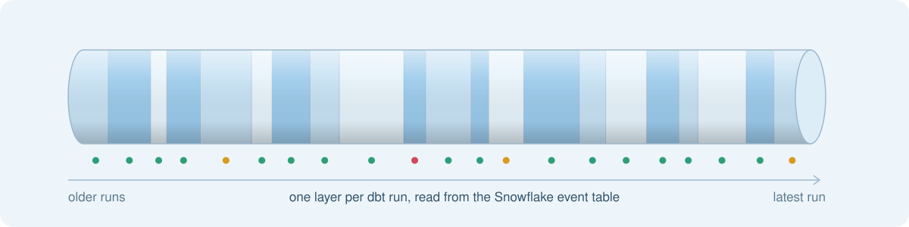
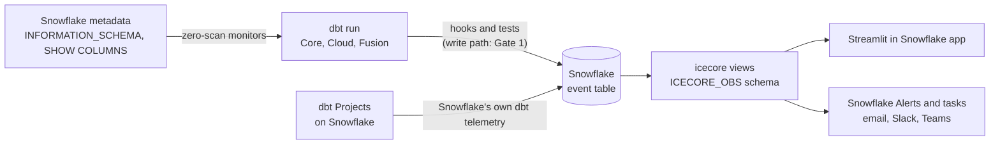

<p align="center">
  
</p>

<h1 align="center">icecore</h1>

<p align="center"><strong>dbt observability that lives inside Snowflake</strong></p>

<p align="center">
  <a href="https://github.com/crithink-dev/icecore/actions/workflows/ci.yml"></a>
  <a href="LICENSE"></a>
  <a href="#compatibility">=1.8 <3.0"></a>
  
  <br>
  <a href="#how-it-works"></a>
  <a href="#how-it-works"></a>
  <a href="#features"></a>
</p>

<p align="center"><sub>The three zeros are design rules. The exception: volume on Iceberg tables falls back to a count over <code>CHANGES</code>, which reads data (<a href="spikes/S5.md">spike S5</a>).</sub></p>

icecore is a dbt package, in development, for teams that run dbt on Snowflake. It is designed to record runs, tests, metrics and cost in Snowflake's own event table, to watch freshness, volume and schema from metadata instead of scanning your data, and to show it all in a Streamlit in Snowflake app: no table to own, no CLI to install, no server to run.

**Why "icecore"?** Scientists drill ice cores to read the past layer by layer. icecore reads your dbt history the same way: every run leaves a layer in the event table, and you read down the core to find when a table went stale, a schema changed or a model got expensive.

> [!IMPORTANT]
> **icecore is pre-release.** It is in Phase 1 (foundations and spikes) and is not on dbt Hub yet. The [Features](#features) table says what is merged today (`shipped`), what is in progress (`building`) and what is still `planned`. How telemetry is written to the event table is decided at Gate 1, after spike S1.

<!-- APP GIF: add docs/assets/icecore-app.gif (Runs, Tests and anomalies, Lineage pages) once the pages read real views. -->

## Try it in 60 seconds

> [!NOTE]
> Available from **0.1.0** (not released yet). The snippets show the planned interface from the [design](docs/design/scope-and-architecture.md); they will not work before the release.

```yaml
# packages.yml
packages:
  - package: crithink-dev/icecore
    version: [">=0.1.0", "<1.0.0"]

# dbt_project.yml
on-run-start: "{{ icecore.start_run() }}"
on-run-end: "{{ icecore.end_run(results) }}"

# models/schema.yml
models:
  - name: fct_orders
    data_tests:
      - icecore.volume
      - icecore.freshness:
          max_lag: 2h
```

Then `dbt deps`, `dbt run-operation icecore.setup` (creates the views in `<target_db>.ICECORE_OBS`) and `dbt build`.

## How it works

icecore has one store, the Snowflake event table, and three paths around it: dbt writes to it, people read views over it, and Snowflake Alerts and tasks watch it.



- **Write path** (`building`). Hooks and tests send run results, test results and metrics to the event table under one scope, `icecore`. The mechanism is chosen at Gate 1. Spike S1 (in review, not merged) found that anonymous Snowflake Scripting blocks write only to the account's event table, and only when the session sets `LOG_LEVEL` and `TRACE_LEVEL`, while a temporary procedure in the target database writes to that database's event table.
- **Read path** (`planned`). `icecore.setup` creates views over the event table. Views are the only public interface: the app and your BI tools read views, never the raw table.
- **Control path** (`planned`). Snowflake Alerts run against the views and notify through a notification integration. A Snowflake task detects runs that never happened.

<!-- SNOWSIGHT TRACE: add docs/assets/icecore-snowsight-trace.png (one dbt invocation as a trace, one span per node) once spans are emitted. -->

## Features

`shipped` means merged on `develop` (not released). `building` means a story is in progress or in review. `planned` means on the [roadmap](docs/superpowers/plans/2026-10-30-icecore-roadmap.md), not started.

| Feature | What it does | Status |
| --- | --- | --- |
| **Zero-scan freshness reader** | `get_last_change_time` reads `SYSTEM$LAST_CHANGE_COMMIT_TIME`, with no warehouse scan. For a dynamic table it reports the last refresh. | `shipped` (macro) |
| **Zero-scan row count reader** | `get_row_count_metadata` reads `INFORMATION_SCHEMA.TABLES.ROW_COUNT` for standard, transient and dynamic tables. Views and external tables are not supported. | `shipped` (macro) |
| **Row count fallback over `CHANGES`** | `get_row_count_changes` counts rows added since the last run, used for Iceberg tables. Cheap only for insert-only windows: after a DELETE or MERGE it read about 1.9 times the bytes of a full scan ([spike S5](spikes/S5.md)). | `shipped` (macro, opt-in) |
| **Schema signature and diff** | `get_columns_signature` reads `SHOW COLUMNS`; `diff_schema` lists added, removed and retyped columns. | `shipped` (macro) |
| **Native anomaly engine** | `score` and `native__score`: pure SQL, seasonal median and MAD bands, the same output fields whatever engine scores. | `shipped` (macro) |
| **Root-cause walk** | `walk_upstream` and `classify_cause` find the nearest upstream failure, schema change or stale source in the dbt graph. Not yet wired to `on-run-end`. | `shipped` (macro) |
| **Streamlit app shell** | Navigation for six pages (Runs, Tests and anomalies, Lineage, Cost, SLAs, Settings) and the views schema setting. Pages show empty states until the views exist. | `shipped` (shell) |
| **Telemetry write path** | How records reach the event table, chosen at Gate 1 from spike S1. | `building` |
| **SLA and alert settings in YAML** | `collect_sla_config` reads `meta.sla` and `meta.alerts` from your models. | `building` |
| **Column monitors over `CHANGES`** | Column metrics computed on changed rows only. | `building` |
| **Elementary compatibility target** | Pin the Elementary release the compatibility views follow; spike S4 on `edr report`. | `building` |
| **Run telemetry hooks** | `icecore.start_run()` and `icecore.end_run(results)`: one span per invocation, one per node, node and test results. | `planned` |
| **Monitor tests** | `icecore.freshness`, `icecore.volume`, `icecore.schema_changes`, `icecore.column_anomaly`, `icecore.dimension_anomaly`. | `planned` |
| **Setup and views** | `icecore.setup` and `icecore.doctor`; views such as `invocations`, `node_executions`, `test_results`, `metrics`, `schema_changes`, `lineage`, `alerts_feed`. | `planned` |
| **Cost per model** | Credits per node from `QUERY_ATTRIBUTION_HISTORY`; cost regressions scored like any metric. | `planned` |
| **Missed-run detection** | A Snowflake task compares `meta.sla` schedules with the last successful run. | `planned` |
| **Alerts** | Snowflake Alerts to email, Slack and Teams, with deduplication and acknowledgement from the app. | `planned` |
| **Cortex engine and shadow scoring** | `SNOWFLAKE.ML.ANOMALY_DETECTION` when the account allows it, compared side by side with the native engine. | `planned` |
| **Traces in Snowsight** | One trace per invocation, one span per node, in Snowsight's trace viewer. | `planned` |
| **Failed-row samples** | A capped sample of failing rows on test failure (payload limits from spike S2). | `planned` |
| **Elementary-compatible views** | Elementary's table names and columns, so existing dashboards keep working. | `planned` |

## How icecore compares

Facts about each tool's design, not a benchmark. The icecore column describes the [design](docs/design/scope-and-architecture.md); the last column says how much of it exists today.

| | Elementary OSS | dbt_artifacts | icecore | icecore status |
| --- | --- | --- | --- | --- |
| **Owns tables** | Yes, inserted from hooks | Yes, uploaded from hooks | No: the event table, read through views | `building` (Gate 1) |
| **Needs a CLI** | Yes, `edr` for the report and alerts | No | No: Streamlit in Snowflake and Snowflake Alerts | `planned` (app shell `shipped`) |
| **Scans data for monitors** | Yes, monitors query the tables | No monitors | Not for freshness, row count and schema; column monitors read changed rows only | readers `shipped`, tests `planned` |
| **Cost per model** | No | No | Yes, from `QUERY_ATTRIBUTION_HISTORY` | `planned` |
| **Detects missed runs** | No | No | Yes, with a Snowflake task | `planned` |
| **Traces in Snowsight** | No | No | Yes, spans in the event table | `planned` |

Why each row holds:

- **Owns tables.** Elementary's package inserts into its own tables from hooks ([spec section 1](docs/design/scope-and-architecture.md#1-vision-and-positioning)); dbt_artifacts uploads dbt's artifacts into its own tables from an `on-run-end` hook. icecore's design writes nothing itself and owns no tables or stages ([section 3](docs/design/scope-and-architecture.md#3-architecture-overview)); hybrid tables are the fallback only if Gate 1 needs one.
- **Needs a CLI.** Elementary needs its Python CLI to render the report and send alerts (section 1). dbt_artifacts produces tables only. icecore's UI is a Streamlit in Snowflake app and its alerts are Snowflake Alerts.
- **Scans data for monitors.** Elementary rescans data to compute metrics (section 1). icecore's shipped readers use metadata only ([spike S5](spikes/S5.md): correct within 2 s for standard, transient and dynamic tables). The `CHANGES` count is cheap only for insert-only windows: after a DELETE or MERGE it read about 1.9 times the bytes of a full scan (S5).
- **Cost per model.** Elementary OSS has no cost data (section 1); dbt_artifacts records execution times, not credits. icecore joins each node's query id to `QUERY_ATTRIBUTION_HISTORY`.
- **Detects missed runs.** A hook only fires when a run happens, so hook-based tools cannot see a run that did not (section 1). icecore's silence task compares declared schedules to the event table.
- **Traces in Snowsight.** Snowsight's trace viewer reads spans from an event table. Of the three, only icecore writes to one.

## Coming from Elementary?

> [!TIP]
> icecore keeps what Elementary got right: run and test results per invocation, failed-row samples, volume, freshness, schema and column monitors, lineage and Slack alerts. **Planned:** opt-in views with Elementary's table names and columns (`dbt_invocations`, `dbt_run_results`, `elementary_test_results` and others), so your dashboards keep working, plus a step-by-step migration guide. Spike S4 checks whether `edr report` can render from them.

## Compatibility

Targets from the design (`require-dbt-version: [">=1.8.0", "<3.0.0"]`). Only dbt Core is tested today.

| Runtime or edition | Target | Tested today |
| --- | --- | --- |
| dbt Core 1.8 to latest | Supported | Yes: CI runs the offline suite on dbt-core 1.8 and on the latest release; the sandbox suite runs on 1.8 |
| dbt Fusion 2.x | Supported | Not yet |
| dbt Cloud | Supported | Not yet |
| dbt Projects on Snowflake (`EXECUTE DBT PROJECT`) | Supported, through Snowflake's own dbt telemetry | Not yet |
| Snowflake Standard edition | Supported, with the account's active event table | Not yet |
| Snowflake Enterprise edition | Supported, optionally with a dedicated database-level event table | Not yet |

Changing the account-level event table needs `ACCOUNTADMIN`. `icecore.setup` is designed to print that statement for an admin, never to run it.

## Learn more

- [Scope and architecture](docs/design/scope-and-architecture.md): the full design, event-table conventions and spikes.
- [Roadmap](docs/superpowers/plans/2026-10-30-icecore-roadmap.md): six phases, three gates.
- [Spike S5](spikes/S5.md): how reliable zero-scan metadata is, per table kind.

## Develop icecore

```bash
cd integration_tests
python3 -m venv .venv && .venv/bin/pip install -r requirements-floor.txt
.venv/bin/pytest -m "not sandbox"      # offline checks
.venv/bin/pytest -m sandbox            # needs SNOWFLAKE_* variables and a bootstrapped sandbox
```

## Contributing

Issues and pull requests are welcome. Start with [Develop icecore](#develop-icecore) to run the test suites, and read the [design](docs/design/scope-and-architecture.md) before proposing a new module.

<a href="https://star-history.com/#crithink-dev/icecore&Date">
  <picture>
    <source media="(prefers-color-scheme: dark)" srcset="https://api.star-history.com/svg?repos=crithink-dev/icecore&type=Date&theme=dark">
    
  </picture>
</a>

**Contributors**

<a href="https://github.com/crithink-dev/icecore/graphs/contributors">
  
</a>

## Licence

Apache-2.0, see [LICENSE](LICENSE). Published by Crithink.
