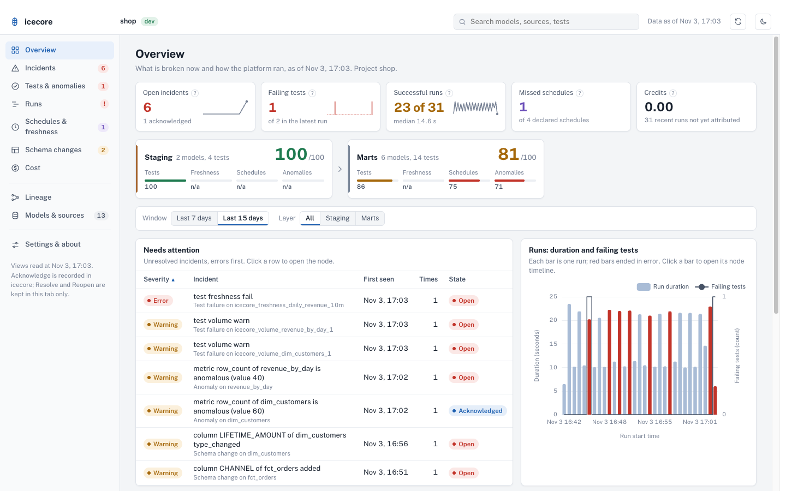
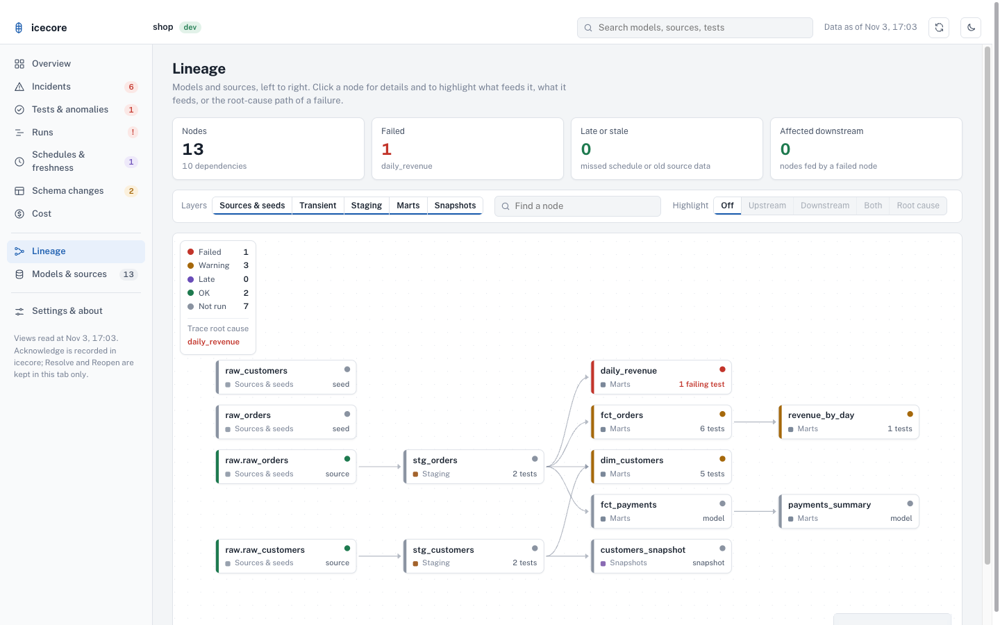
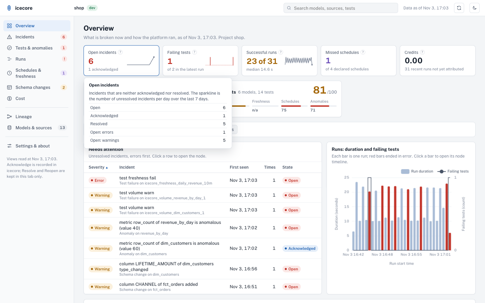

# The icecore app: the Console

The app is the **Console**: one full-page app, a single Streamlit component. It reads only the icecore views (the [views reference](reference/views.md)), never the event table. Its one write is acknowledging an incident, through the `ICECORE_ACK` procedure. You can run it on your laptop (recommended) or deploy it to Streamlit in Snowflake.



## What is in it

The left menu has these sections. Each one shows 3 to 5 KPI tiles, a filter bar (window of 7 or 15 days, and layer), one main chart and one main table with failures first. Clicking a row opens the node page.

| Section | What it answers |
| --- | --- |
| Overview | What is broken now and how the runs went: open incidents, failing tests, successful runs, missed schedules, credits; a health score per layer; the incidents that need attention; a chart of run duration and failing tests. |
| Incidents | Every incident of `ALERTS_FEED`, open, acknowledged and resolved. Acknowledge is here. |
| Tests and anomalies | Test results and scored metrics, with the metric's expected band. |
| Runs | Each dbt invocation and the timeline of its nodes. |
| Schedules and freshness | Declared schedules (`meta.sla`), missed runs, and source freshness against its limit. |
| Schema changes | Columns added, removed or retyped. |
| Cost | Credits per run and per model, from the query attribution the cost reader records. |
| Lineage | The DAG, left to right, with a status overlay, upstream and downstream highlight, the root-cause path, a layer filter and a node search. |
| Models and sources | Every node, with its page: status history, tests, metrics, schema, cost. |
| Settings and about | What `setup` detected (edition, event table, levels, Cortex), and the data-quality list of views that could not be read. |

A search box in the top bar opens any model, source or test. The top bar also has a refresh button and a light and dark theme switch.



Each tile has a help text that says how its number is computed.



**Layers.** The layer cards (and the layer filter) follow your project's own layers. A model's layer is the first folder under `models/` (`models/bronze/orders.sql` is `bronze`); seeds, snapshots and sources use their resource type. To rename folders, use the `layers` var, for example `layers: {brz: bronze}` ([Configuration](configuration.md#the-icecore-var)). The layer is recorded when the run writes, so a record keeps the layer it had then.

**Refresh and cache.** The app reads the last 30 days once and filters the window and layer in the browser. The data is cached for 5 minutes. The refresh button in the top bar clears the cache and reads the views again. The footer of the menu shows when the views were read.

**Acknowledge.** On an open incident, Acknowledge calls `ICECORE_ACK` with the incident key. The procedure refuses a key that is not a current unacknowledged incident and records your own Snowflake user as the acknowledger. The views show it after a few seconds (event-table delay); until then the app shows the incident as acknowledged. Resolve and Reopen are kept in the browser tab only.

**Views that cannot be read.** If a view is missing or the role cannot read it, the app still opens. A red bar lists each view and its error, and the sections that depend on it show what is recorded so far.

## Where the app reads from

The app takes the views schema (`DATABASE.SCHEMA`, plain unquoted identifiers, upper-cased) from the first of these that applies:

1. The `ICECORE_VIEWS_SCHEMA` environment variable (local runs).
2. `views_schema = "DB.SCHEMA"` in an optional `streamlit/icecore_app.toml`, next to `streamlit_app.py`. This is the way to set it in Streamlit in Snowflake. Upload it with the other files (`PUT file://streamlit/icecore_app.toml @<db>.<schema>.<stage>/icecore_app`), or add it to the `artifacts` of `snowflake.yml`.
3. The app's own schema, when the app is created in the views schema (`CREATE STREAMLIT <db>.<views schema>.ICECORE_APP`). It needs no setting and is the recommended path for a deployed app.
4. `<current database>.ICECORE_OBS`, the schema `icecore.setup` creates.

## Run the app on your laptop (recommended)

**Why**

- No warehouse stays up for the app. A Streamlit in Snowflake object needs a warehouse while someone has it open; a local run holds a Snowflake session only while you use it.
- It reads only the views. Nothing is installed in the account for the app, and it writes nothing except an acknowledgement you click.
- It costs only the queries you make: a few small selects on the views, cached for 5 minutes.

**How**

1. Clone the repository (the app is in `streamlit/`; it is not part of the dbt package install) and install the packages (Python 3.10 to 3.13):

   ```bash
   git clone https://github.com/crithink-dev/icecore.git && cd icecore
   python3 -m venv .venv-app
   .venv-app/bin/pip install -r streamlit/requirements-local.txt
   ```

2. Tell the app how to log in. Use one of:

   - a connection name: `export SNOWFLAKE_CONNECTION_NAME=<name>`, an entry of your `connections.toml`. The Snowflake library reads that file; the app never opens it.
   - a key pair: `SNOWFLAKE_ACCOUNT`, `SNOWFLAKE_USER`, `SNOWFLAKE_PRIVATE_KEY_PATH` (and `SNOWFLAKE_PRIVATE_KEY_PASSPHRASE` if the key has one).
   - the browser login: `SNOWFLAKE_ACCOUNT` and `SNOWFLAKE_USER` only. Snowflake opens a browser window.

   `SNOWFLAKE_ROLE`, `SNOWFLAKE_WAREHOUSE` and `SNOWFLAKE_DATABASE` are optional. The role needs USAGE on the database and the views schema, SELECT on the views, and USAGE on `ICECORE_ACK` to acknowledge. The warehouse is used only while the data loads.

3. Say where the views are, then start it:

   ```bash
   export ICECORE_VIEWS_SCHEMA=<DB>.ICECORE_OBS
   make app                                          # or scripts/run_app_locally.sh
   ```

   The app is at <http://localhost:8501>. `PORT=8600 make app` changes the port. `scripts/run_app_locally.sh` makes the virtualenv on first run if `.venv-app` does not exist (`VENV=<path>` uses another one). Keep `HOST` as `localhost`: the app uses your Snowflake session, so anyone who can reach the address can read the views as you.

With no login configured the app opens and shows its empty state, with the error in the data-quality list.

**Try it with demo data.** `make demo-data` (`scripts/demo_data.sh`) runs a copy of [examples/shop](../examples/shop/README.md) several times into a demo schema (`<DB>.ICECORE_DEMO` for the models, `<DB>.ICECORE_DEMO_OBS` for the icecore views). It needs a dbt-snowflake environment and the login variables above, and creates objects only in those two schemas. For a fuller demo (scored metrics, anomalies, schema changes, SLAs, a freshness breach, failed and skipped models, and open, acknowledged and resolved incidents) run `make rich-demo` (`scripts/demo/build_rich_demo.sh`): 15 real runs, about 30 minutes, and it refuses to run outside the `ICECORE_SANDBOX` database, the project's own test database. Credits fill a few hours later: Snowflake publishes query attribution with a lag, and a later dbt run writes the credits it finds.

## Deploy it to Streamlit in Snowflake

Do this if your team wants one shared URL. Inside Snowflake the app uses the active session, so the login variables do not apply. It needs a warehouse, running while someone has the app open.

**What must ship.** The Console is a bundled component: the built files in `streamlit/components/console/build/` (an `index.html` and an `assets/` folder with the script, the styles and the layout worker) must be uploaded with the Python files. Without them the app opens blank. There is no CDN: everything the browser loads is in that folder.

The files, relative to `streamlit/`:

- `streamlit_app.py`, `environment.yml` and `.streamlit/config.toml`, and `icecore_app.toml` if you set the views schema that way;
- `lib/__init__.py`, `ack.py`, `console_component.py`, `console_data.py`, `incidents.py`, `queries.py`, `settings.py` and `status.py`;
- `components/console/build/index.html` and `components/console/build/assets/*`.

The packages are in `environment.yml` (Streamlit 1.50.0 and Snowpark, from the Snowflake Anaconda channel). That file applies on the warehouse runtime; the account's default container runtime ignores it, which is why `snowflake.yml` sets `runtime_name: SYSTEM$WAREHOUSE_RUNTIME`.

### Option 1: upload to a stage and create the object

This is the path that worked in our sandbox. `PUT` keeps no folder structure, so upload each folder to its own path of the stage. With the Snowflake CLI (`snow sql`) or any client that supports `PUT`, from the repository root:

```sql
CREATE STAGE IF NOT EXISTS <db>.<schema>.<stage>;

PUT file://streamlit/streamlit_app.py            @<db>.<schema>.<stage>/icecore_app                          AUTO_COMPRESS=FALSE OVERWRITE=TRUE;
PUT file://streamlit/environment.yml             @<db>.<schema>.<stage>/icecore_app                          AUTO_COMPRESS=FALSE OVERWRITE=TRUE;
PUT file://streamlit/.streamlit/config.toml      @<db>.<schema>.<stage>/icecore_app/.streamlit               AUTO_COMPRESS=FALSE OVERWRITE=TRUE;
PUT file://streamlit/lib/*.py                    @<db>.<schema>.<stage>/icecore_app/lib                      AUTO_COMPRESS=FALSE OVERWRITE=TRUE;
PUT file://streamlit/components/console/build/index.html   @<db>.<schema>.<stage>/icecore_app/components/console/build         AUTO_COMPRESS=FALSE OVERWRITE=TRUE;
PUT file://streamlit/components/console/build/assets/*     @<db>.<schema>.<stage>/icecore_app/components/console/build/assets  AUTO_COMPRESS=FALSE OVERWRITE=TRUE;
```

Then create the app from the stage:

```sql
CREATE OR REPLACE STREAMLIT <db>.<views_schema>.ICECORE_APP
  FROM '@<db>.<schema>.<stage>/icecore_app'
  MAIN_FILE = 'streamlit_app.py'
  QUERY_WAREHOUSE = <warehouse>;
```

`lib/*.py` also uploads `health.py`, which the app does not import; it does no harm. To update, run the `PUT`s again (`OVERWRITE=TRUE`) and reopen the app.

### Option 2: `snow streamlit deploy`

`streamlit/snowflake.yml` is a Snowflake CLI project definition that lists the same files, with the build folder, for a manual deployment:

```bash
cd streamlit
snow streamlit deploy --replace
```

It is a sandbox-style definition: its `identifier`, `query_warehouse` and database values are the project's test ones, so change them to yours first. In our sandbox this command failed at the upload step, which is why Option 1 is the documented path. Try it if your CLI version works for you.

### Who can open it

The role that views the app needs **USAGE on the STREAMLIT object**:

```sql
GRANT USAGE ON STREAMLIT <db>.<views_schema>.ICECORE_APP TO ROLE <viewer_role>;
```

A Streamlit in Snowflake app runs with the rights of its owner role, so that role needs USAGE on the database and the views schema, SELECT on the views, and USAGE on `ICECORE_ACK` for the Acknowledge button ([what `setup` creates](configuration.md#what-setup-creates)). See [Where the app reads from](#where-the-app-reads-from) for the views schema: create the app in the views schema and nothing else is needed.

Local and deployed show the same Console.
